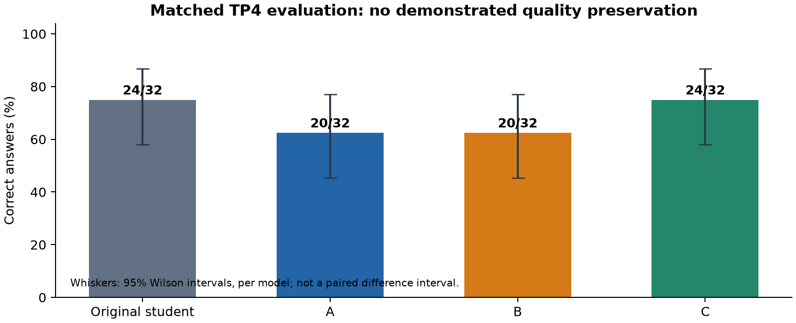
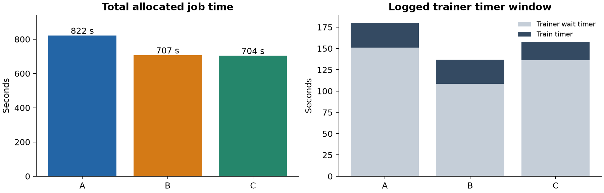
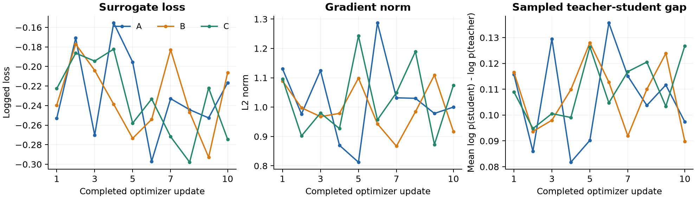
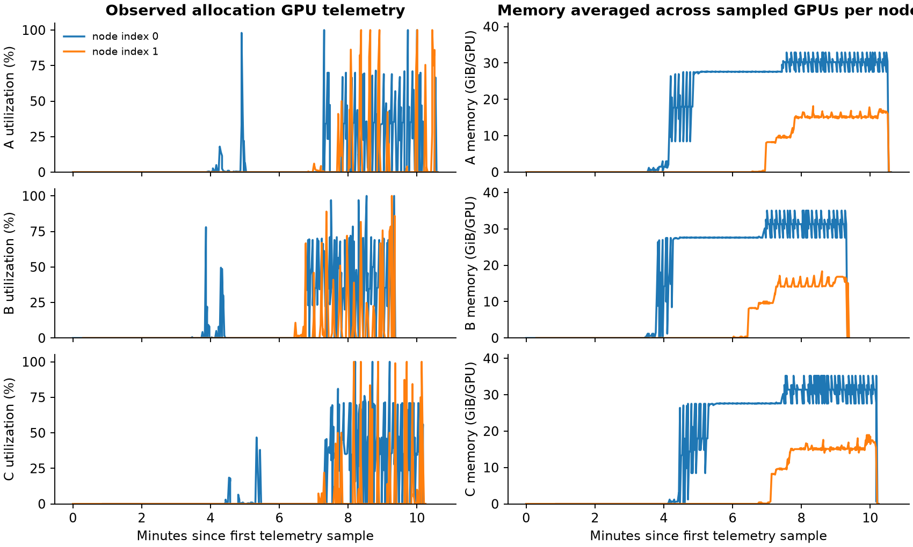

# MATH policy-distillation pilot: A/B/C report

Report date: 29 October 2026. Training completed on 28 October; checkpoint evaluations completed on 29 October. This report covers the initial 1.5B-student/7B-teacher MATH pilot, not earlier synthetic or larger-model attempts.

## Findings

All three conditions completed ten finite optimizer updates, repeated weight publication, model-only checkpoint saving and HF export. All three exports subsequently loaded and completed matched evaluation without request or grading failures. Exact optimizer-state restoration was neither available nor tested.

The original student scored **24/32**, A **20/32**, B **20/32**, and C **24/32** on the same development questions. A and B were 12.5 percentage points below the matched baseline; C tied it. With only 32 questions and one short training run per condition, this does not establish learning or acceptable shortcut quality loss. No acceptance margin has been agreed.

C's distinctive behavior was exercised: **38/80 accepted responses spanned policy versions**, while B had zero mixed-version responses. Accepted response age stayed within the configured bound (A zero; B/C at most one publication). The async filter discarded seven groups in B and nineteen in C. Training truncation was very high: 67/80 in A, 68/80 in B, and 67/80 in C hit 2,048 tokens.

## Execution and workload

| Condition | Training job | Allocated time | GPU-hours | Accepted response tokens | Training truncation | Evaluation |
|---|---|---:|---:|---:|---:|---:|
| A | 14702480 | 13m42s | 1.827 | 158,868 | 67/80 | 20/32 |
| B | 14702481 | 11m47s | 1.571 | 157,073 | 68/80 | 20/32 |
| C | 14702486 | 11m44s | 1.564 | 158,000 | 67/80 | 24/32 |

Each condition used eight A100 GPUs across two AI nodes, four GPUs per node, 64 GiB host RAM per node and 17 allocated CPU cores per node. Training used four GPUs (TP2 x DP2), student generation two GPUs (TP2), and frozen teacher scoring two GPUs (TP2). A used cn02/cn04; B and C used cn02/cn03. Actual jobs ran sequentially despite being eligible concurrently. Other allocations could share the hosts; their contention was not measured. Physical NIC/switch paths were not established.

Each run used batch eight, microbatch one, ten updates, Adam at learning rate 1e-6, BF16 and full activation recomputation. Responses were sampled at temperature one, top-p one, with a 2,048-token response cap and 4,096-token total context. The prompt cap was 2,048 tokens. Accepted-token totals are reconstructed from logged mean response length x response count; they are not independently measured post-mask optimizer token counts. Eighty accepted responses do not imply eighty unique prompts or one dataset epoch.

A is round-synchronous. B overlaps production with training but drains active responses before publishing new weights. C permits interrupted/resumed mixed-version responses. B/C use Slime's dynamic sampling filter to drop and replace groups older than one publication; malformed/future version metadata and mixed-version B responses remain fatal. This selection rule is part of the evaluated implementation, not a pure scheduling-only intervention.

## Data separation

The pinned MATH training source contains 7,500 rows. Preparation retained 3,000 prompt-only training rows, 256 disjoint development rows and 4,239 reserved rows, stratified by subject and difficulty. Four rows lacked an extractable answer; one row was removed by the duplicate/overlap check. Answers and worked solutions were stored separately from training prompts. Normalized exact matching (NFKC, whitespace collapse, casefold) checked exclusion against all 500 MATH-500 questions; semantic overlap and prior model pretraining exposure remain unknown.

The current evaluation uses only the pre-existing 32-question MATH-500 development subset. The other 468 questions remain reserved and were not evaluated. The separate 256-row MATH development split was not used in these evaluations. All A/B/C training files share SHA256 `7d1b34e890cee856a700bea81e870b69d2be69ac497a602f61390f35b6216379`.

## Matched checkpoint evaluation

Greedy generation, 8,192 response tokens, batch eight, TP4, BF16, SGLang Triton attention, CUDA graphs disabled, context 12,288, 600-second request timeout, and Slime's `grade_answer_verl`. Each evaluation used four GPUs on one regular GPU node with a 30-minute cap. All 32 question indices were present exactly once per model; data hash, tokenizer hash, decoding, batch size and grader match the new baseline.

| Model | Evaluation job | Correct | Truncated | Failures |
|---|---|---:|---:|---:|
| Original student | 14728542 | 24/32 (75.0%) | 8/32 | 0 |
| A | 14728534 | 20/32 (62.5%) | 11/32 | 0 |
| B | 14728535 | 20/32 (62.5%) | 10/32 | 0 |
| C | 14728536 | 24/32 (75.0%) | 7/32 | 0 |

Relative to the matched original student, A gained zero questions and lost four; B gained one and lost five; C gained one and lost one. Each question is 3.125 percentage points. The intervals shown below are per-model Wilson intervals, not confidence intervals for paired differences. These development results must not be used as final held-out quality certification.

Historical TP2 baseline scores were student 22/32 and teacher 27/32. They are retained as context, not pooled with the TP4 comparison. The new TP4 original-student score is 24/32, illustrating why serving settings must be matched.

## Optimization and timing

| Condition | Collection wall s | Actor compute s | Train timer s | Trainer wait s | Publication s | Wait / (wait + train) |
|---|---:|---:|---:|---:|---:|---:|
| A | 117.90 | 12.80 | 29.01 | 150.98 | 4.34 | 83.9% |
| B | 11.23 | 11.74 | 28.40 | 108.55 | 4.42 | 79.3% |
| C | 93.35 | 12.76 | 21.46 | 136.11 | 13.34 | 86.4% |

The train timer includes work beyond actor forward/backward, including recorded log-probability work. Trainer wait measures time outside its train timer; it is not an isolated measurement of generation or teacher scoring. Collection measures how long a batch consumer waits for already-produced work; B's low collection time does not mean its rollouts were generated at that speed. Teacher request times overlap across requests and must not be added as serial wall time.

The trainer timer windows cover only part of allocated runtime. Startup, model loading, checkpoint/export and other orchestration occupy substantial unpartitioned time. Do not sum collection, wait, publication and compute as disjoint stages, or infer a critical-path decomposition from these aggregate timers. B/C have lower observed total job time than A, but different accepted sequences, discard work, placement and unmeasured contention prevent a causal speedup claim from this single run.

Total training allocation: **4.962 GPU-hours**. Four matched quality evaluations including the original student: **5.294 GPU-hours**. Combined: **10.257 GPU-hours**, excluding earlier failures, preparation, historical baselines and queue time.

## Policy behavior and learning diagnostics

| Condition | Maximum accepted age | Stale accepted | Mixed-version accepted | Discarded groups / observed candidates | Questions gained / lost |
|---|---:|---:|---:|---:|---:|
| A | 0 | 0/80 | 0/80 | 0 (0.0%) | 0 / 4 |
| B | 1 | 72/80 | 0/80 | 7 (8.0%) | 1 / 5 |
| C | 1 | 60/80 | 38/80 | 19 (19.2%) | 1 / 1 |

Discard percentages use dropped groups / (80 accepted + dropped), with one response per group. They exclude unconsumed work remaining at shutdown, so they are not a complete wasted-compute fraction. All logged losses and gradient norms were finite, and every update had a nonzero gradient norm. The loss is a sampled policy-gradient surrogate; negative values and fluctuations do not directly indicate answer quality. The sampled log-probability gap is not an exact distribution KL, and these runs do not evaluate all prompts at a common fixed policy.

## GPU observations

Telemetry samples at two-second intervals cover two node indices and four GPU indices on each node. Curves show averages over the sampled GPUs per node. The report does not assign node indices to trainer/generator/teacher roles without a verified role-to-device map. GPU memory, utilization and power are observations, not measurements of achieved model FLOP utilization or a roofline. Peaks can be missed by interval sampling. CSVs and topology/network snapshots remain in the run directories.

## Reproducibility and evidence

- Student: `deepseek-ai/DeepSeek-R1-Distill-Qwen-1.5B`, revision `ad9f0ae0864d7fbcd1cd905e3c6c5b069cc8b562`.
- Frozen teacher: `deepseek-ai/DeepSeek-R1-Distill-Qwen-7B`, revision `916b56a44061fd5cd7d6a8fb632557ed4f724f60`.
- MATH source: `DigitalLearningGmbH/MATH-lighteval`, revision `0530c78699ea5e8eb5530600900e1f328b48acad`, `data/train-00000-of-00001.parquet`.
- Slime: `18868a79b0b083a093798a94ed0f8cb4f71b9c14`.
- Immutable source provenance: snapshot Git base `b3aed46c99c2c335488bc13af689cebbe550c7d4` plus launch/hooks/test overlays from `856cbdd`, recorded by `MATH_REVISION`. The manifest's base Git revision alone does not identify the overlays; adapter hashes are retained in [summary.json](summary.json).
- Runtime: Torch 2.13.0+cu130, Ray 2.59.0, SGLang 0.5.21, Transformers 5.12.1, Transformer Engine 2.18.0, FlashAttention 2.8.3. AI training used Apptainer 1.4.1; regular GPU evaluations used 1.4.4.
- Remote evidence base: `/project/nk_meshapplied/edotenv/math-pilot-20261028`. Per condition: `A-a1`, `B-a1`, `C-a1`, their `train/manifest.json`, `train/train.log`, `train/checkpoints/iter_0000009`, `train/hf-checkpoints/9`, GPU CSVs and topology/network snapshots. Evaluation directories end in `-evaluation-a1`.
- Data evidence: `/project/nk_meshapplied/edotenv/small-validation-20261028/math-data-a1/manifest.json`.
- W&B: one numeric relay run per condition and separate evaluation records; private workspace details and credentials are not stored in this public report. Training also retained offline W&B records. Relay delivery was periodic, not native online Slime delivery.

## Decision and next steps

The implementation now passes this short MATH execution/save/load/evaluation path for A/B/C. C's mixed-version shortcut was exercised. This is not a successful learning or noninferiority result: only 80 responses were optimized per condition, most training responses were truncated, A/B scored lower than the matched starting student, and no acceptable quality-loss threshold was predefined.

Before a longer comparison, calibrate response/context budgets on development data, decide a quality-loss tolerance, and run enough accepted training tokens to establish a useful synchronous reference. Then compare async conditions at matched training work with multiple seeds and explicit discard/selection accounting. Optimize measured stage capacity and GPU placement after addressing truncation; deeper profiling and a roofline remain separate diagnostics. Earlier scalar-reward, mount, runtime, Ray, publication-memory, save-memory and lag-limit failures remain recorded in the experiment journal and are not erased by these successes.
